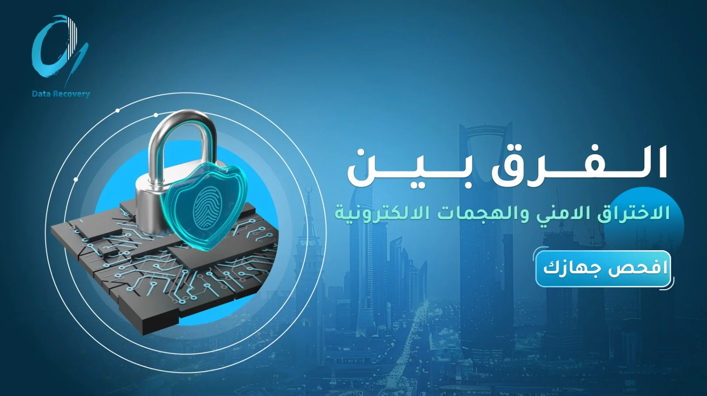

إذا كنت من مستخدمي الإنترنت، فمن المؤكد أنك سمعت بمصطلحي **الهجمات الإلكترونية والاختراق الأمني**، وربما تعتقد أنهما يشيران إلى الشيء نفسه، لكن في الحقيقة هناك فرق جوهري بينهما.

**الهجوم الإلكتروني** هو محاولة متعمدة وضارة لاختراق أنظمة الكمبيوتر أو الشبكات أو الأجهزة بهدف إلحاق الضرر بها أو الوصول إلى بياناتها. 

**الاختراق الأمني** فيحدث عندما تنجح هذه المحاولة في الوصول غير المصرح به إلى [استعادة البيانات مع شركة زيرو تو وان](https://datarecovery-sa.com/) أو التطبيقات أو الشبكات أو الأجهزة، أو السيطرة عليها دون إذن.

سنتعرف بالتفصيل على الفرق بين الهجمات الإلكترونية والاختراق الأمني، وأبرز أنواع كل منهما، وكيف يمكنك حمايه الاجهزه وبياناتك من هذه الجرائم الإلكترونية.

**اختراق البيانات ليس نفس الاختراق الأمني فليس كل هجوم إلكتروني ينجح في إحداث اختراق أمني، وليس كل اختراق أمني ناتجًا عن هجوم إلكتروني مباشر.**

## ماهي الهجمات الإلكترونية؟

**الهجوم الإلكتروني (Cyberattacks)** هو أي محاولة متعمدة ينفذها مجرمو الإنترنت باستخدام جهاز كمبيوتر واحد أو عدة أجهزة، بهدف الوصول غير المصرح به إلى شبكاتك أو أجهزتك وهذا الهجوم قد ينجح أو يفشل.

الهجوم الإلكتروني الخطوة الأولى والمحاولة المباشرة لكسر الدفاعات، حيث يسعى المهاجم إما لتعطيل النظام وإخراجه عن الخدمة، أو لاستغلاله للوصول إلى البيانات الحساسة وتدميرها أو تسريبها وهو ما يعرف بالاختراق الأمني.

## ما هو الاختراق الأمني؟

تعريف الاختراق الإلكتروني او الاختراق الامني (Security Breach) هو حادث تقني يحدث عندما ينجح شخص غير مصرح له، مثل المخترقين أو القراصنة، في تجاوز خطوط الدفاع والأنظمة الأمنية لمنظمة أو فرد، والوصول إلى البيانات الحساسة أو التطبيقات أو الأجهزة أو الشبكات المغلقة، مما يتيح له الاطلاع على أمن المعلومات أو سرقتها أو التلاعب بها.

ويشمل ذلك سرقة قواعد بيانات العملاء أو كلمات المرور أو السجلات المالية والبطاقات الائتمانية، أو الدخول إلى لوحة تحكم الموقع أو السيرفر الرئيسي أو البريد الإلكتروني للمؤسسة، بالإضافة إلى الوصول إلى المستندات الحساسة وتغيير بياناتها أو حذفها. 

وقد يحدث الاختراق أيضا نتيجة أخطاء بشرية، مثل اطلاع موظف على ملفات حساسة ليست من صلاحياته، أو ترك ملف سحابي مفتوح للعامة عن طريق الخطأ.

## الهجوم الإلكتروني والاختراق الأمني

ولتوضيح الفرق، تخيل أن هناك لصا يحاول دخول منزلك؛ فمحاولته كسر الباب أو استخدام أدوات لاقتحامه تشبه الهجوم الإلكتروني، أما إذا نجح بالفعل في الدخول والوصول إلى ممتلكاتك، فهذا يشبه الاختراق الأمني.

معرفتك للفرق بين الاختراق الأمني والهجوم الالكتروني يساعدك على فهم حجم الخطر الذي قد تتعرض له وكيف تتعامل معه وتحمي بياناتك وسمعتك. ولتفهم أكثر دعنا نتكلم عن أربع حالات مختلفة:

1. هجوم إلكتروني نجح وأدى إلى الاختراق الأمني

يحدث هذا النوع من الهجمات عندما يحاول شخص اختراق نظامك الرقمي وينجح بسبب ضعف الحماية. مثلا يرسل المهاجم إيميل مزيف لأحد الموظفين، ويضغط الموظف على الرابط الموجود فيه ويدخل كلمة المرور. هنا يقدر المهاجم يدخل على نظام الشركة ويطلع على ملفاتها ويسرق بياناتها.

2. هجوم فشل ولم يحدث أي اختراق

تتعرض الشركات والأنظمة يومياً لمحاولات اختراق كثيرة، لكن أنظمة الحماية القوية تنجح في إيقافها قبل أن يتمكن المهاجم من الدخول. 

مثلا يحاول أحد المهاجمين تخمين كلمة مرور حساب المدير عدة مرات، لكن النظام يوقف المحاولات ويحظر الحساب تلقائيا بعد ثلاث محاولات خاطئة وهنا حدث هجوم، لكنه فشل ولم يقع أي اختراق.

3. اختراق حدث بدون أي هجوم

ليس كل اختراق بحاجة إلى مجرم سيبراني أو نشر برمجية خبيثة فقد يحدث الاختراق الأمني نتيجة خطأ بشري أو إهمال أمني، مثلا يرفع موظف ملف يحتوي على أرقام وهويات العملاء على الإنترنت وينسى وضع كلمة سر لحمايته، فيدخل شخص غريب ويحمّل الملف. هنا حدث اختراق وتسريب للبيانات بسبب سوء الإعدادات، دون إطلاق أي هجوم تقني.

4. هجوم نجح في التعطيل دون أن يمس البيانات

بعض الهجمات هدفها إرباك العمل وإيقافه فقط، وليس سرقة المعلومات، مثل يوجه مهاجم ملايين الزيارات الوهمية في ثانية واحدة نحو موقع متجر إلكتروني (هجوم حجب الخدمة DDoS)، فيتوقف الموقع عن العمل لساعات. هنا نجح الهجوم في تعطيل المتجر، لكنه لم يستطع التسلل للداخل أو سرقة بيانات البطاقات والعملاء.

من الحالات الأربعة السابقة تقدر توصل الى نتيجة بسيطة: نجاح الهجوم الإلكتروني قد يوصلك للاختراق لكن ليس كل هجوم هو اختراق، وليس كل اختراق سببه هجوم، وهما مختلفين من حيث: المفهوم والهدف، إمكانية النجاح، المصدر، الأثر.

|  | الهجوم الالكتروني | الاختراق الأمني |
| **المفهوم** | محاولة متعمدة لاستهداف نظام أو شبكة | وصول غير مصرح به إلى نظام أو حساب أو بيانات |
| **إمكانية النجاح** | قد ينجح وقد يفشل | يتضمن نجاح في تجاوز الحماية. |
| **الهدف المباشر** | سرقة البيانات أو تعطيل الخدمات أو استغلال النظام | الوصول للبيانات، سرقتها، تشفيرها، أو التحكم بالنظام. |
| **المصدر** | مقصود ويتطلب إطلاق أداة أو تكتيك هجومي | قد يحدث بهجوم أو بدون هجوم مثل خطأ موظف أو إعداد خاطئ |
| **الاكتشاف** | لحظة الهجوم | قد يستغرق أسابيع أو أشهر |
| **الأثر** | إجهاد السيرفرات أو توقف مؤقت للخدمات. | خسائر مالية، سرقة أسرار، وضرر دائم لسمعة المؤسسة. |

## أمثلة الاختراق الأمني

تعرف أمثلة الاختراق الأمني (اوالهجمات السيبرانية) بأنها محاولات ضارة تستهدف أنظمة الحاسوب، والشبكات، والأجهزة الرقمية بغرض اختراقها أو السيطرة عليها، تعطيل خدماتها، او سرقة البيانات الحساسة منها.

**وتمثل هذه التهديدات التحدي الأكبر الذي يسعى الأمن السيبراني للتصدي له والدفاع عن الأنظمة ضده.**

### أبرز الاختراقات الأمنية وأكثرها شيوعاً

التصيد الاحتيالي (Phishing) والهندسة الاجتماعية: تعد التهديد الأكبر والأكثر انتشاراً، حيث تستهدف خداع المستخدمين لسرقة بياناتهم.

- [**برامج فيروس الفدية (Ransomware)**](https://datarecovery-sa.com/blog/ransomware-in-riyadh/): هجمات تقوم بتشفير ملفات الضحية وطلب فدية مالية مقابل استرجاعها.
- **البرمجيات الخبيثة (Malware) و** [**فيروس حصان طروادة**](https://datarecovery-sa.com/blog/trojan-horse-virus/): برامج ضارة تتسلل للأنظمة لتخريبها أو التجسس عليها.
- **هجمات حجب الخدمة (DoS و DDoS)**: محاولات لغمر الأنظمة بالطلبات لإخراجها عن الخدمة وتعطيلها.
- **هجمات حقن SQL**: ثغرات تستهدف قواعد البيانات لاختراقها أو استخراج معلومات منها.
- **الهجمات المدعومة بالذكاء الاصطناعي والتزييف العميق**: أحدث التهديدات وأكثرها خطورة، حيث تستخدم التقنيات الحديثة لتنفيذ هجمات ذكية ومعقدة.

## أنواع الهجمات الالكترونية والاختراق الأمني؟

الاختراق الأمني مو بالضرورة يصير بسبب هجوم كبير ومعقد، فقد يبدأ برسالة مزيفة تصل جوالك، أو رابط تضغط عليه، أو برنامج تحمله دون ما تعرف أنه ضار:

### أولاً: أنواع الهجمات الإلكترونية

قد تتعرض لأنواع مختلفة من الهجمات الإلكترونية، تختلف بحسب الطريقة التي يستخدمها المهاجم لمحاولة إلحاق الضرر بك أو الوصول إلى بياناتك. مثلا قد تتعرض لهجوم إغراق المواقع، عندما يرسل المهاجم عدد كبير من الطلبات الوهمية إلى الموقع الذي تستخدمه في الوقت نفسه ليتسبب في إبطائه أو تعطيله تماما.

وقد يحاول شخص ما تخمين كلمة مرور حسابك باستخدام برامج آلية تجرب آلاف أو ملايين الكلمات في وقت قصير حتى تعثر على الكلمة الصحيحة. وهناك أيضاً هجمات حقن الأكواد التي يحاول فيها المهاجم إدخال أوامر خبيثة في موقع إلكتروني، مثل مربع البحث أو تسجيل الدخول، لخداع الموقع والحصول على معلومات لا يفترض أن تكون متاحة له.

أما هجمات الاعتراض فقد تحدث عندما تستخدم شبكة واي فاي عامة غير آمنة، فيتمكن المهاجم من التجسس على البيانات التي ترسلها أو تستقبلها، مثل كلمات المرور أو المعلومات الشخصية.

### ثانيا: أنواع الاختراق الأمني

أما الاختراق الأمني، فيحدث عندما يتمكن شخص غير مصرح له من الدخول إلى جهازك أو حسابك أو الوصول إلى بياناتك الخاصة.

وقد يحدث الاختراق عن طريق الخداع، مثل أن تصلك رسالة مزيفة تبدو وكأنها من البنك، فتضغط على الرابط وتدخل كلمة المرور، مما يسمح للمحتال بالدخول إلى حسابك.

وقد يحدث أيضا بسبب البرامج الخبيثة والضارة، مثل برامج الفدية التي تقفل ملفاتك وتطلب المال لاستعادتها، أو برامج التجسس التي تراقب نشاطك وتجمع معلوماتك دون علمك.

كما قد يحدث الاختراق بسبب خطأ بشري غير مقصود أو ضعف في الحماية، مثل ترك قاعدة بيانات العملاء متاحة للجميع دون كلمة مرور، أو استغلال أحد الموظفين لصلاحياته للوصول إلى معلومات لا يحق له الاطلاع عليها أو تسريبها وهو ما يسمى بالاختراق الداخلي

## كيف تتحول الهجمات الالكترونية إلى اختراق أمني؟

قد يحاول شخص اختراق جهازك أو حسابك بأكثر من طريقة، لكن متى تنجح محاولته ويدخل فعلا إلى بياناتك؟ هناك عدة أسباب تساعد المهاجم على النجاح منها: 

1. **كلمات المرور الضعيفة**: استخدام كلمات سر سهلة التخمين، أو تكرار نفس كلمة السر لحسابات العمل والحسابات الشخصية.
2. **تجاهل التحقق الثنائي**: عدم تفعيل خاصية رمز التحقق على الجوال يجعل الحصول على كلمة السر وحدها كافياً لدخول النظام.
3. **عدم تفعيل الجدار الناري (Firewall)**: لحماية الاتصال بالإنترنت ومراقبة المنافذ المفتوحة في الحاسوب.
4. **تأجيل التحديثات الأمنية باستمرار**: التأخر في تحديث البرامج والأنظمة والسيرفرات يترك الثغرات الأمنية مفتوحة ومتاحة للاستغلال.
5. **أخطاء الإعدادات**: ترك المنافذ والخدمات مفتوحة دون حماية، أو رفع قواعد البيانات على السحابة ونسيان وضع كلمة سر لها
6. **إعطاء صلاحيات أعلى من الحاجة**: منح موظف واحد صلاحية الوصول لكامل ملفات وبيانات الشركة مما يعني أن اختراق حسابه وحده يعرض المنشأة بالكامل للخطر.
7. **ضعف حماية حسابات المسؤولين (الآدمن)**: عدم تشديد الحماية على الحسابات ذات الصلاحيات العالية.
8.  **ضعف أدوات الحماية**: الاعتماد على برامج حماية قديمة لا تستطيع اكتشاف الهجمات المتقدمة. يجب استخدام برامج مكافحة الفيروسات والتجسس مثل Kaspersky أو Windows Defender.
9. **غياب المراقبة المستمرة**: عدم متابعة حركة الشبكة وسجلات الدخول، مما يتيح للمهاجم التسلل والتنقل داخل الأنظمة لأسابيع دون أن يشعر به أحد.

## ما الأضرار التي تسببها الهجمات والاختراقات؟

قد تكون أضرار الهجمات الإلكترونية والاختراقات الأمنية أكبر من مجرد تعطل جهاز أو حساب، فقد تؤثر على أموالك وبياناتك وسير عملك، فمن الممكن أن تتعرض لخسائر مالية بسبب سرقة الأموال أو الابتزاز، أو تفقد بيانات مهمة نتيجة تسريبها أو حذفها أو تشفيرها.

وقد تتعطل أنظمة منشأتك ومواقعها الإلكترونية، مما يؤثر على سير العمل وخدمة العملاء. كذلك، قد تفقد ثقة عملائك وتتأثر سمعة منشأتك، وقد تواجه مساءلة قانونية إذا تسبب الاختراق في تسريب بيانات شخصية أو عدم الالتزام بمتطلبات حمايتها.

| **نوع الضرر** | **مثال** |
| **مالي** | سرقة الأموال أو الابتزاز |
| **تشغيلي** | توقف الموقع أو المتجر |
| **السمعة** | فقدان ثقة العملاء |
| **قانوني** | تبعات مخالفة متطلبات حماية البيانات |
| **تسريب بيانات** | كشف معلومات العملاء |

## ماذا تفعل إذا تعرضت لهجوم إلكتروني؟

إذا تعرضت لهجوم إلكتروني أو اختراق أمني، اتبع الخطوات التالية بسرعة لتقليل الأضرار وحماية بياناتك وضمان استمرار أعمالك:

1. **ابدأ بحماية ما لم يتأثر**: اعزل الأجهزة المشتبه بها عن الشبكة إن أمكن، واستخدم جهازًا سليمًا للتواصل. أبقِ النسخ السليمة منفصلة عن البيئة المتضررة.
2. **افصل الأجهزة المتضررة عن الإنترنت والشبكة الداخلية**: لمنع انتشار الهجوم إلى أجهزة وأنظمة أخرى، مع تجنب إطفاء الأجهزة أو العبث بها قبل استشارة الفريق التقني للحفاظ على الأدلة الرقمية.
3. **غير كلمات المرور**: حدث كلمات مرور الحسابات المهمة باستخدام جهاز آمن، وتأكد من تأمين الحسابات التي يحتمل تعرضها للاختراق.
4. افحص الأنظمة والأجهزة: استعِن بالفريق التقني لتحديد مصدر الهجوم، وطريقة حدوثه، وحجم تأثيره على الأنظمة.
5. **حدد حجم الأضرار**: تحقق مما إذا كان المهاجم قد وصل إلى بيانات العملاء أو المعلومات المالية أو ملفات الشركة، واحتفظ بسجلات الأنظمة والأدلة الرقمية دون حذفها.
6. **تحقق من النسخ الاحتياطية**: تأكد من سلامة النسخ الاحتياطية وخلوها من البرمجيات الضارة قبل استخدامها لاستعادة البيانات.
7. **أزل التهديدات وعالج الثغرات**: تخلص من البرمجيات الضارة، وعالج السبب الأساسي للاختراق لمنع تكراره.
8. **استعن بمتخصصين عند الحاجة**: إذا كان الهجوم واسع النطاق أو يصعب السيطرة عليه، اطلب مساعدة خبراء الأمن السيبراني لاحتواء التهديد واستعادة الأنظمة بأمان.

**انتبه**: قرار إطفاء الجهاز يعتمد على القدرة على عزله وخطر استمرار الضرر وحاجة المختص إلى حفظ الأدلة. لا تنفذ إطفاءً جماعيًا لخوادم الشركة اعتمادًا على صفحة إرشادية؛ اطلب توجيه مسؤول الاستجابة.

## نصائح Zero2One لحماية أجهزتك وحساباتك من الهجمات الالكترونية والاختراق الأمني

مثل ما تحرص على إغلاق باب بيتك بالكامل، لازم تحرص على حماية أجهزتك وحساباتك بنفس القدر، خطوات بسيطة نوصيك بها في Zero 2 One تحميك وتختصر عليك المتاعب:

1. **استخدم كلمة السر طويلة**: تتضمن مزيج من الحروف والأرقام والرموز وابتعِد عن الأمور السهلة مثل تاريخ ميلادك أو اسمك.
2. **لا تكرر كلمة السر**: احرص على تنويع كلمات السر.
3. **احذف حساباتك القديمة**: الحساب اللي ما تستخدمه اقفله فورا.
4. **جدد كلمات السر باستمرار**: تغيير كلمة السر كل فترة يقطع الطريق على أي محاولة تسلل.
5. **امسح جهازك القديم صح**: إذا أردت التخلص من كمبيوترك القديم استخدم برنامج يفرمت الجهاز ويمسح البيانات نهائيا.
6. **احفظ نسخة احتياطية**: احفظ ملفاتك المهمة على هاردسك خارجي، لتكون بأمان لو تعرضت لبرمجيات الفدية أو التشفير.
7. **أمن جوالك**: حدث نظام جوالك أولا بأول.
8. **حمل برنامج حماية موثوق**: احرص على وجود برنامج مكافحة فيروسات فعال على حاسوبك يفحص الملفات باستمرار.
9. لا تشارك بياناتك الشخصية بسهولة: لا تعطي أي موقع معلوماتك الخاصة مثل تاريخ الميلاد أو السجل المدني إلا إذا كان هناك حاجة فعلية لذلك.
10. **انتبه من الروابط المشبوهة**: لا تضغط على أي رابط أو ملف وصلك في إيميل أو رسالة غريبة، حتى لو كانت من اسم تعرفه إلا بعد أن تتأكد.

## كيف تساعدك شركة Zero2One لحماية اجهزتك واستعادة البيانات

لا تنتظر حتى تقع في أزمة لتبحث عن الحلول، فالحماية الحقيقية تبدأ من هندسة المنصة الرقمية بشكل صحيح، نحن في Zero2One لاستعادة البيانات لا نكتفي بتصميم وتطوير مواقعك ومتجرك الإلكتروني فحسب، بل نبني لك أنظمة رقمية مخصصة تمنحك بيئة عمل آمنة ومستقرة.

### الخلاصة

الآن صارت الصورة أوضح: الهجوم الإلكتروني هو محاولة لاستهداف جهازك أو حسابك أو أنظمتك، أما الاختراق الأمني فيحدث عندما تنجح المحاولة ويصل المهاجم إلى بياناتك أو يستخدم أنظمتك دون إذن. 

لكن تذكر أن مو كل هجوم يعني اختراق فقد ينجح المهاجم في تعطيل خدماتك دون الوصول إلى بياناتك، وقد يحدث الاختراق بسبب ثغرة أمنية أو إعدادات غير آمنة.

وسواء كنت تحمي حساباتك الشخصية أو تدير منشأتك، لا تنتظر حتى تتعرض للمشكلة خذ خطواتك من الآن لحماية بياناتك وتقليل المخاطر، أو دع خبراء Zero2One يساعدونك في إنشاء مواقع آمنة.

## الأسئلة الشائعة

### ما الفرق الأساسي بين الهجوم الإلكتروني والاختراق الأمني؟

الهجوم هو المحاولة أو الفعل الهجومي المباشر، بينما الاختراق هو النتيجة الناجحة للهجوم والتي يتم فيها الوصول الفعلي وغير المصرح به للبيانات.

### ما القاسم المشترك بين الهجوم الإلكتروني والاختراق الأمني؟

القاسم المشترك هو استهداف الأصول الرقمية والسعي للوصول غير المصرح به، والتسبب في أضرار تشغيلية أو مالية وتعريض البيانات للخطر وخسارة السمعة في النهاية.

### هل كل هجوم إلكتروني يؤدي إلى اختراق أمني؟

 لا، فكثير من الهجمات تفشل أمام جدران الحماية وأنظمة الأمان القوية، وتتحطم على أسوار المنشأة الرقمية دون إلحاق أي ضرر بالبيانات.

### ما هي أهداف الهجمات الإلكترونية والأهداف المحتملة للاختراق؟

تتنوع الأهداف بين سرقة البيانات الحساسة، التجسس على الأنشطة، ابتزاز المنشآت ماليا، تعطيل الخدمات التشغيلية، أو التخريب وتدمير السمعة التجارية.

### اذكر أمثلة عن الأدوات المستخدمة في الهجمات الإلكترونية؟

 البرمجيات الخبيثة، الفيروسات، برامج التجسس، نصوص الحقن البرمجي، شبكات البوتنت (Botnets)، وأدوات فحص الثغرات الآلية.

###  كم مرة تحدث الهجمات الإلكترونية؟

تحدث بشكل مستمر ومتزايد على مدار الساعة عالميا حيث تستهدف البرامج الآلية والمخترقون الأنظمة والمتاجر الإلكترونية بحثا عن أي ثغرة أمنية.

### هل اختراق البيانات هو نفسه الاختراق الأمني؟

لا، الاختراق الأمني مفهوم أوسع يشمل الوصول غير المصرح به إلى الأنظمة أو الحسابات، بينما اختراق البيانات يعني الوصول إلى بيانات أو معلومات دون إذن، وقد يكون أحد نتائج الاختراق الأمني.

### ما الأخطاء الشائعة التي تجعل المؤسسات عرضة للهجمات؟

ضعف كلمات المرور، إهمال التحديثات الدورية، غياب النسخ الاحتياطي، منح صلاحيات واسعة دون حوكمة، ونقص وعي الموظفين بأساليب التصيد الإلكتروني.
