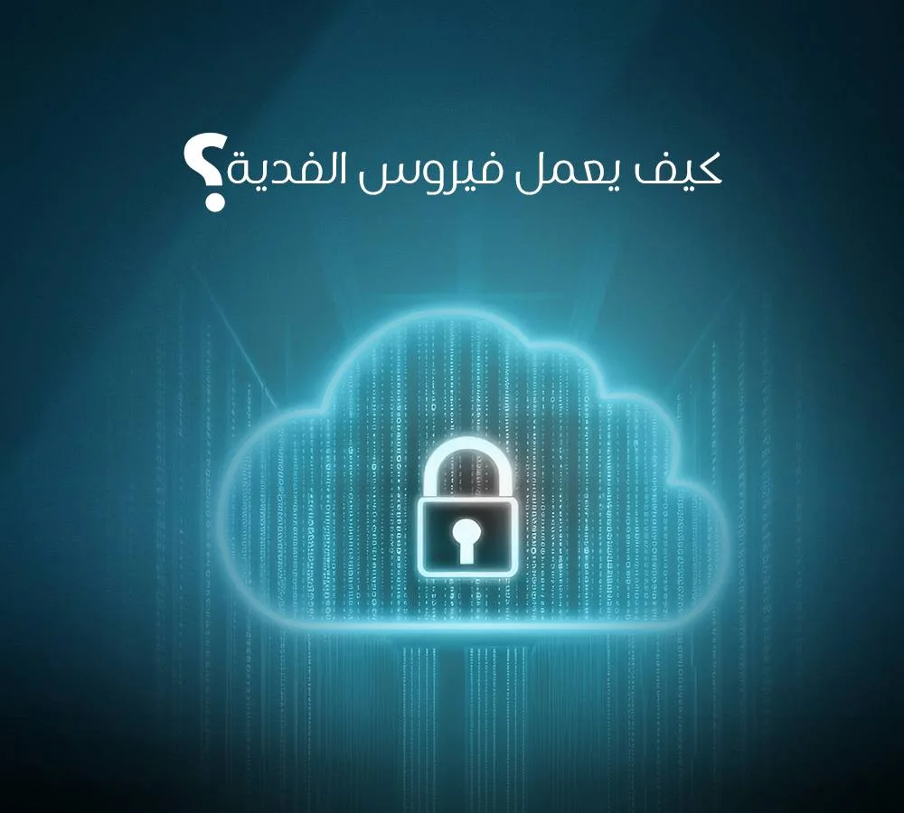
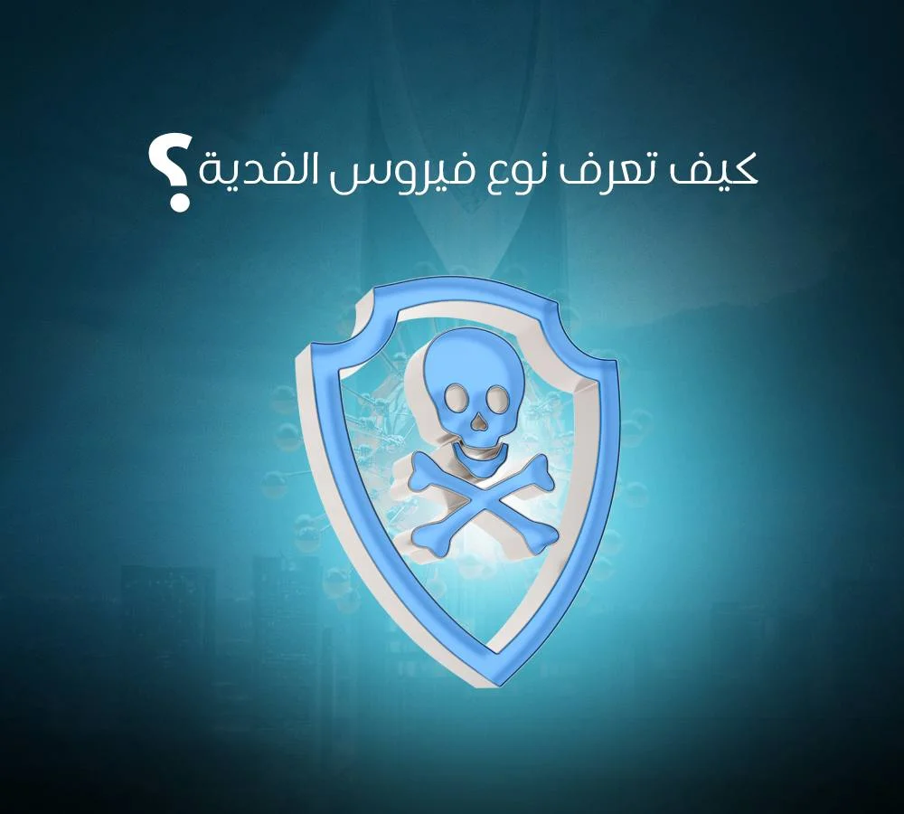

ظهرت رسالة على جهازك تقول إن ملفاتك أصبحت مشفرة، وتطلب دفع مبلغ مالي لاستعادتها. ما نوع هذا الهجوم، وما أفضل وقاية مسبقة منه؟ هجوم تصيد بسيط ولا حل له فيروس عادي يحل بإعادة تشغيل الجهاز فقط هجوم فدية (ransomware)، وأفضل وقاية هي أخذ نسخ احتياطية دورية لملفاتك.

تتصاعد أخطار الابتزاز الرقمي يوماً بعد يوم ، حيث تشير التقارير الأخيرة إلى ارتفاع أنشطة التهديدات السيبرانية الموجهة نحو الأسواق العربية بنسبة تجاوزت 20 ضعفاً، ولا سيما في السعودية والإمارات العربية المتحدة ومصر. 

ومع تضاعف الهجمات وتجاوز خسائر الحادثة الواحدة ملايين الدولارات، أصبح البحث عن حل مشكلة فيروس  ransomware و[استعادة البيانات](https://datarecovery-sa.com/ransomware/) الأشد خطورة ضرورة قصوى لحماية المؤسسات والأفراد وتفادي توقف الأعمال. 

## ما هو فيروس الفدية؟

"فيروس الفدية Ransomware" او هجوم الفدية هو بمثابة برنامج الذي يقفل ملفات المستخدم ويطلب مبلغاً مالياً يسمي بحصان طروادة لانه من الممكن ان يخترق جهازك عن طريق برامة مجهولة او ملفات تعريف الارتباط (Cookies)

وهو نوع خطير من البرمجيات الخبيثة يقوم بتشفير بيانات المستخدم واحتجازها كرهينة، أو حتى قفل جهازه بالكامل وحجب الوصول إليه، ثم يطالب بدفع فدية مالية غالباً ما تكون ضخمة مقابل فك التشفير. 

وتكمن المعضلة الرئيسية للضحايا في البحث عن حل مشكلة فيروس ransomware والوصول إلى أساليب آمنة تضمن إعادة الملفات فيروس الفدية دون الرضوخ لمطالب المبتزين.

تصنف هجمات فيروس الفدية اليوم في المرتبة الثالثة بين أكثر أساليب الهجمات السيبرانية استخداماً. ولا يقف شخص واحد أو جهة واحدة خلفه، بل تتنوع الجهات القائمة عليه لتشمل مبتكرين أفراداً، وعصابات إجرامية منظمة، وجيوشاً إلكترونية تابعة لدول.

مع تسجيل أكثر من 7.500 ضحية علنياً وزيادة سنوية تجاوزت 24.9 %، بات التهديد الرقمي يلاحق المؤسسات والأفراد عالمياً. وخلف هذه الأرقام المخيفة يقف " فيروس الفدية Ransomware " او هجوم الفدية. 

### من يقف وراء فيروس الفدية الخبيثة الذي اجتاح العالم

تاريخياً، بدأ الأمر عام 1989 مع عالم الأحياء التطورية (Joseph Popp) الذي أطلق أول فيروس فدية معروف باسم "AIDS Trojan" عبر آلاف الأقراص المرنة المصابة. وتطور المشهد لاحقاً ليصبح قطاعاً إجرامياً منظماً تقوده شبكات وعصابات قرصنة محترفة. 

تعتمد على نموذج "الفدية كخدمة" لابتزاز الشركات والمؤسسات بهدف جني الأرباح، وصولاً إلى مجموعات مدعومة من حكومات ودول تمتلك قدرات متقدمة لتعطيل البنية التحتية العالمية؛ كما حدث في هجمات WannaCry الشهيرة التي وقعت في مايو 2017 وشلت في غضون أيام قليلة مئات الآلاف من أجهزة الكمبيوتر في أكثر من 150 دولة.

 وبما أن فيروس الفدية يعد خطراً مستمراً وتحدياً أمنياً حاضراً بقوة، فإن البحث عن علاج فيروس الفدية أصبح ضرورة قصوى لكل مؤسسة تسعى للحفاظ على استقرارها؛ لذا واصل القراءة لتكتشف حل مشكلة فيروس ransomware و كيف تحمي أصولك الرقمية وتُقلل مخاطر هذه الهجمات.

## امتدادات فيروس الفدية

امتدادات فيروس الفدية (Ransomware Extensions) هي لواحق وفواصل يضيفها الفيروس إلى نهاية أسماء الملفات بعد أن يقوم بتشفير محتواها وإغلاقها وجعل الوصول إليها مستحيلاً. 

تعتبر هذه الامتدادات بمثابة "توقيع رقمي" للجهة المهاجمة؛ إذ تغير صيغة الملف الأصلية إلى صيغة جديدة غير قابلة للفتح بواسطة البرامج الاعتيادية، كما تستخدم لإرهاب الضحية ولإشعارها بأن ملفاتها أصبحت محتجزة بنجاح. 

على سبيل المثال لدينا تقرير سنوي (Word): قبل التشفير (الملف الأصلي): Yearly_Report.docx، وبعد التشفير (بواسطة فيروس الفديةQilin ): Yearly_Report.docx.qilin وما حدث هنا أن الفيروس أبقى على اسم الملف وامتداده الأصلي ولكنه أضاف لاحقة .qilin في النهاية، مما يمنع برنامج Microsoft Word من قراءته.

تساعد هذه الامتدادات خبراء الأمن السيبراني في التعرف على نوع الفيروس والسلالة المسؤولة عن الهجوم وهنا جمعنا لك أشهر امتدادات فيروسات الفدية (حسب العائلة والانتشار)

### ما هو شكل فيروس الفدية؟

لا يوجد شكل واحد ثابت لفيروسات الفدية، فهي برمجيات خبيثة (Malware) تُكتب باستخدام لغات البرمجة المختلفة، ومن أمثلتها BadBlock. غالبًا ما تظهر آثار الإصابة بعد تشفير الملفات من خلال تغيير خلفية الشاشة إلى صورة حمراء أو سوداء تحتوي على تحذيرات أو رسائل تهديد، بالإضافة إلى ظهور ملف نصي تلقائيًا داخل المجلدات أو على سطح المكتب يوضح أن الملفات تم تشفيرها ويطالب بدفع مبلغ مالي مقابل استعادتها.

## كيف يعمل فيروس الفدية تقنياً؟

فيروس الفدية ليس مجرد برنامج يهدف إلى إتلاف النظام، بل هو برمجية خبيثة تستخدم لابتزاز الضحايا مالياً. بمجرد وصوله إلى الجهاز، قد يبدأ في البحث عن الملفات المهمة، مثل المستندات المالية وقواعد البيانات والصور ومقاطع الفيديو، وقد يمتد تأثيره إلى الأجهزة والخوادم المتصلة بالشبكة.

بعد ذلك، يستخدم فيروس الفدية تقنيات تشفير، مثل AES أو RSA، لمنع الوصول إلى الملفات دون مفتاح فك التشفير المناسب. 

وعند اكتمال العملية، تظهر رسالة تطالب الضحية بدفع مبلغ مالي مقابل استعادة الملفات، وقد تتضمن مهلة زمنية وتهديدات بحذف مفتاح فك التشفير أو زيادة مبلغ الفدية.

**ملاحظة**: لا تضمن عملية الدفع استعادة الملفات، لذلك يُنصح بعزل الجهاز المصاب عن الشبكة والاستعانة بمتخصص في الاستجابة للحوادث واستعادة البيانات.

## كيف تصل فيروسات الفدية إلى الأجهزة والشبكات؟

تعتمد هذه البرمجيات على استغلال الثغرات التقنية والأخطاء البشرية:

1. **رسائل التصيد الاحتيالي (Phishing & Spear,Phishing)**: أصبحت موجهة بعناية، قد يتلقى الموظف رسالة تبدو وكأنها من مديره المباشر أو من جهة حكومية تحتوي على ملف بصيغة (PDF أو Word) ملغم ببرمجية خبيثة تبدأ بالتنفيذ بمجرد النقر عليها.
2. **استغلال بروتوكول سطح المكتب البعيد (RDP)**: يعتبر من أخطر الثغرات في الشركات. يقوم المهاجمون باستخدام برامج لتخمين كلمات المرور لمنافذ RDP المفتوحة على الإنترنت، وبمجرد الدخول، يصبح لديهم تحكم كامل لتعطيل برامج الحماية وزرع الفيروس.
3. **التحميل الخفي (Drive,by Downloading)**: مجرد زيارة موقع ويب مخترق قد يؤدي إلى تحميل الفيروس تلقائياً في خلفية نظامك دون الحاجة للنقر على أي زر تحميل، وذلك عبر استغلال ثغرات المتصفح.
4. **الإعلانات الخبيثة (Malvertising)**: يتم دس أكواد خبيثة داخل إعلانات تظهر على مواقع شرعية وموثوقة، وبمجرد ظهور الإعلان أو النقر عليه، تبدأ عملية اختراق الجهاز.

## امتدادات فيروس الفدية في 2026

### امتدادات مجموعات الفدية الأكثر نشاطاً وانتشاراً في 2026

- .**qilin**: يضيفه فيروس Qilin، أنشط الفيروسات مؤخراً، استهدفت أكثر من 1,000 هجوم عبر قطاعات الرعاية الصحية، التصنيع، والمالية
-  **lockbit**: يتبع لسلسلة LockBit الشهيرة والتي عادت للظهور مع الإصدار LockBit 5.0.
- akira: خاص بمجموعة Akira (ثاني أكثر المجموعات نشاطاً)، والتي تستهدف بيئات Windows وLinux وESXi.
- **dragonforce**: يتبع لمجموعة DragonForce التي وقفت خلف هجمات بارزة لشركات كبرى مثل Marks & Spencer.
- **play**: خاص بفيروس Play والمعروف أيضاً بـ Playcrypt و يعتمد تكتيكات الابتزاز المزدوج.
- **interlock**: خاص بمجموعة Interlock التي تسببت باختراقات ضخمة لقطاعات الرعاية الصحية.
- clop أو cl0p: يتبع لمجموعة Cl0p التي تستغل ثغرات اليوم الصفر (Zero-day) في منصات نقل الملفات.
- **medusa**: خاص ببرمجية Medusa التي تستهدف قطاعات التعليم، الحكومة، والرعاية الصحية..
- blackcat / .ALPHV: خاص بفيروس BlackCat. 
-  **rhub**: يُضيفه فيروس RansomHub.  

### امتدادات عامة وشائعة جداً (تستخدمها سلالات متعددة)

- .**locked**: من أكثر الامتدادات شيوعاً، وتشير إلى أن الملف "مغلق".
- **.crypto / .enc / .encrypted**: امتدادات عامة ترمز إلى كلمة (Encrypted) أو (Crypto). 
-  .**djvu / .STOP**: تصيب أجهزة الأفراد والمستخدمين العاديين عبر التنزيلات غير الآمنة.    
- سلالات تاريخية خطيرة: 
- .**wannacry**: اشتهر بانتشاره العالمي السريع عام 2017 وتسببه في شلل قطاعات حيوية واسعة.
- **locky**: عرف بهجماته الشرسة في التشفير عبر حملات البريد الإلكتروني.
- **cryptolocker**: من أولى سلالات الفدية وأساس منظومة برمجيات الفدية الحديثة. 
- **petya**: برمجية شديدة التدمير تقوم بتشفير القرص الصلب بالكامل وحظر الجهاز.
- **notpetya**: النسخة الأكثر شراسة من Petya، والتي كبّدت الاقتصاد العالمي خسائر بمليارات الدولارات عام 2017.
- **ryuk**: استهدف المؤسسات الكبرى للحصول على فديات ضخمة بالعملات المشفرة قبل أن يتطور لاحقاً إلى Conti.
- **dharma**: سلالة مرنة تطورت عبر السنوات واستخدمت امتدادات متعددة مثل .wallet و.java.
- **phobos**: فائقة السرعة في التشفير واستخدمت امتدادات مثل .deimos و.epic.
- djvu: من سلالات عائلة STOP، وتستهدف البيانات الشخصية بشكل خاص. 

وعلى الرغم من أن تغيير الامتداد هو العلامة الأوضح والأكثر شيوعاً للتشفير، إلا أن استراتيجيات المهاجمين تطورت كثيراً إذ لم تعد جميعها تعتمد على تغيير امتدادات أسماء الملفات، حيث يتجه المهاجمون إلى أساليب أخرى مثل التشفير الداخلي لمحتوى الملف مع إبقاء اسمه ظاهرياً كما هو، أو الابتزاز المباشر عبر سرقة البيانات والتهديد بنشرها دون تشفيرها. 

## أنواع فيروس الفدية

للأسف بات من السهل وبأقل التكاليف على المجرمين السيبرانيين إطلاق الهجمات، نظراً لتوفر البرمجيات الخبيثة بأسعار رخيصة وفي متناول الجميع على شبكة الإنترنت المظلم (Dark Web). 

ويتيح التمييز بين الإنترنت المظلم والإنترنت العميق (Deep Web) للمؤسسات استيعاب كيفية عمل هذه الأسواق غير المشروعة وطرق الحصول على أدوات التهديد، وهو ما يسهل على خبراء الأمان تحديد علاج فيروس الفدية المناسب والحد من آثاره. هناك عدة أنواع من هذه الفيروسات:

### 1. فيروسات الفدية المشفرة (Crypto / Encrypting Ransomware):

هو النوع الأكثر انتشاراً؛ حيث لا يمنعك الفيروس من فتح جهاز الكمبيوتر، ولكنه يقوم بتشفير ملفاتك المهمة مثل الصور، المستندات، مقاطع الفيديو، وقواعد البيانات ويغير امتدادها، أي تظل الملفات موجودة أمامك على الجهاز لكنك لا تستطيع فتحها إطلاقاً، وتظهر لك رسالة تطلب دفع مبلغ مالي مقابل إعطائك مفتاح فك التشفير مما يدفع الضحايا للبحث عن حل مشكلة تشفير الملفات بفيروس الفدية.

### 2. فيروسات حظر الشاشة / النظام (Lockers) :

 نوع يستهدف قفل جهاز الكمبيوتر أو نظام التشغيل بالكامل ومطالبة الفدية عبر شاشة رئيسية تمنع الوصول للملفات أو رؤية أسمائها أو امتداداتها وقد تنتحل أحياناً صفة جهة حكومية أو أمنية وتستدعي الحادثة التدخل الفوري لـ علاج فيروس الفدية.

### 3. برمجيات الابتزاز ( Doxware / Leakware):

 نوع يعتمد على سرقة البيانات ونقلها إلى خوادم المهاجم قبل أو بدون تشفيرها. لا يهتم الهكرز هنا بقفل ملفاتك، بل يهددون بنشر معلوماتك الحساسة مثل أسرار الشركة، بيانات العملاء، أو الصور الشخصية على شبكة المظلمة (Dark Web) أو إرسالها للمنافسين إذا لم تدفع الفدية وهو ما يفرض تطبيق استراتيجيات متقدمة للوصول إلى حل مشكلة فيروس ransomware.

- **البرمجيات التدميرية الوهمية**

 برمجيات خبيثة تتخفى في شكل فيروس فدية وتطلب المال، لكن هدفها الحقيقي هو التدمير فقط، إذ تقوم بحذف البيانات وإتلافها نهائياً، وحتى لو قام الضحية بدفع الفدية فلن يتمكن من استعادة ملفاته لأن المهاجمين لا يمتلكون خياراً أو مفتاحاً لإعادتها أساساً.

- **برمجيات الترهيب (Scareware):**

 تظهر في شكل تنبيهات أو رسائل تحذيرية مزيفة تفيد بأن جهازك مصاب بفيروسات خطيرة أو أنك ارتكبت مخالفة قانونية وتُطالب الضحية بدفع مبلغ لشراء برنامج حماية وهمي أو لتسوية الغرامة المزيفة لإزالة الخطر.

- **الفدية كخدمة (Ransomware as a Service - RaaS)**

يقصد "الفدية كخدمة " قيام مخترق محترف بتأجير برمجياته الخبيثة لمهاجمين آخرين، متولياً كافة تفاصيل العمليات من التوزيع وإدارة الفدية إلى استعادة البيانات، لقاء الحصول على حصة من الأرباح. 

وفي جميع هذه الحالات، يبقى الوعي واستخدام الحلول المعتمدة بواسطة خبرا مختصين هو الطريق الأمثل لـ حل مشكلة فيروس الفدية وحماية البيانات.

## أضرار فيروس الفدية

فيروس الفدية لم يعد مجرد إزعاج فردي، بل تحوّل إلى مشكلة أمنية وعالمية تترك آثاراً مباشرة وغير مباشرة تتفاقم مع استمرار الهجمات، منها: 

### شلل العمليات وتوقف الخدمات: 

تمثل فترة التوقف عن العمل السلاح الأبرز للمهاجمين للضغط على الضحايا؛ حيث تشير الإحصاءات إلى أن انقطاع الخدمات يمتد في المتوسط إلى 21 يوماً، مما يؤدي إلى شلل تام في العمليات التشغيلية.هذا الانقطاع الممتد لا يقتصر على تعطل المبيعات، بل قد ينتهي بإفلاس الشركات المتضررة وإغلاقها نهائياً. وعادةً ما تسابق المؤسسات الزمن لإيجاد طريقة ناجعة تضمن حل مشكلة فيروس ransomware بأسرع وقت ممكن.

### الخسائر المالية الضخمة وتآكل الأصول

تتجاوز التكاليف المالية قيمة الفدية المطلوبة لتشمل مصاريف التعافي وعلاج فيروس الفدية والاستجابة للأزمات؛ على سبيل المثال كبدت حادثة فدية واحدة في 2018 مدينة أتلانتا نحو 17 مليون دولار لإصلاح أنظمتها وهذه الكلفة لا تأخذ بالحسبان تكلفة الخدمات المفقودة بالنسبة للمجتمع.

### تغذية المنظومة الإجرامية (الدورة المفرغة)

إن الاستسلام لمطالب المهاجمين يدخل الضحايا في حلقة مفرغة؛ إذ تستخدم أموال الفدية في تمويل أبحاث جديدة وتطوير أدوات اختراق أكثر تعقيداً تستفيد منها شبكات الجريمة المنظمة والدول المعادية. 

كما أن الاعتماد الكلي على التأمين دون الاستثمار الجاد في الحماية يولد حالة من المخاطرة الأخلاقية التي تزيد من شراسة الهجمات المستقبليّة و يحتم على الخبراء وضع استراتيجيات شاملة لـ حل مشكلة فيروس ransomware من جذورها.

### الابتزاز المتعدد

 تطور ابتزاز المهاجمين إلى الابتزاز الثلاثي، حيث يتواصل القرصان مباشرة مع عملاء الشركة المتضررة وشركائها لتهديدهم وتسريب بياناتهم الخاصة ما لم تدفع الشركة الفدية.

### التبعات القانونية

تستمر معانة المؤسسات والمنظمات حتى بعد انتهاء الهجوم؛ إذ تفرض هيئات حماية البيانات غرامات باهظة بسبب التقصير في حماية البيانات. 

كما تواجه الشركات مسائلة قانونية إذا حولت أموال الفدية لجهات مدرجة على لوائح العقوبات الدولية، إلى جانب التعرض لدعاوى قضائية جماعية يرفعها العملاء المتضررون.

### تدمير السمعة والقيمة السوقية

لعل أهم التأثيرات هو فقدان الشركات والمؤسسات ميزتها التنافسية وهروب العملاء إلى المنافسين نتيجة تراجع الثقة بها، فضلاً عن الصعوبة البالغة في حل مشكلة تشفير الملفات بفيروس الفدية دون ترك ندوب واضحة على سمعة المؤسسة.

### التلف الهيكلي وإجهاد الكوادر

في كثير من الأحيان، تتسبب أدوات التشفير المعقدة أو البرامج الرديئة لفك التشفير في تلف دائم للبيانات والأجهزة، بشكل يجعل مهمة اعادة الملفات فيروس الفدية بالغة الصعوبة.

## كيفية معرفة نوع فيروس الفدية

| **نوع الفيروس** | **آلية العمل التقنية** | **الأثر ومستوى الخطورة** | **أمثلة شهيرة** |
| تشفير الملفات (Crypto Ransomware) | يبحث عن امتدادات ملفات محددة ويقوم بتشفير محتواها وتغيير امتدادها. | مرتفع: يفقد المستخدم الوصول لبياناته الحيوية، لكن النظام يستمر في العمل. | WannaCry, Locky, Ryuk |
| قفل الجهاز (Locker Ransomware) | لا يشفر الملفات الفردية، بل يقفل واجهة المستخدم (شاشة الدخول) ويمنع الوصول للنظام. | متوسط: البيانات غالباً غير مشفرة، ويمكن لخبراء التقنية تخطي واجهة القفل. | Reveton, WinLocker |
| الابتزاز المزدوج (Double Extortion) | يقوم بنسخ وسرقة البيانات الحساسة إلى خوادم المهاجمين أولاً، ثم يشفرها في جهاز الضحية. | حرج جداً: خطر ابتزاز بنشر البيانات السرية للجمهور أو المنافسين. | REvil, Maze, DarkSide |
| برمجيات الفدية كخدمة (RaaS) | نموذج عمل يقوم فيه مطور الفيروس بتأجيره لقراصنة آخرين مقابل نسبة من الأرباح. | متصاعد: سمح لغير الخبراء بشن هجمات مدمرة، مما ضاعف من عددها عالمياً. | Conti, Cerber |

## **كيف تعرف نوع فيروس الفدية الذي أصاب جهازك؟**

تحديد نوع الفيروس بدقة يوفر الكثير من الوقت والجهد على الخبراء في شركة **من الصفر الى الواحد**:

- **مراقبة التغيير في امتدادات الملفات:** معظم الفيروسات تضيف بصمتها الخاصة للملف، فمثلاً يتحول ملف "تقرير.docx" إلى "تقرير.docx.locked" أو سلسلة من الأحرف العشوائية.
- **تحليل رسالة الفدية:** اقرأ الملف النصي المتروك على سطح المكتب (مثل README.txt). عنوان البريد الإلكتروني للمهاجم أو تصميم الرسالة يكشف غالباً عن عائلة الفيروس.
- **أدوات التحليل المجانية:** مشاريع متخصصة تتيح لك رفع عينة من الملف المشفر ورسالة الفدية لتحليلها وتحديد ما إذا كان هناك مفتاح فك تشفير متاح.

 السرعة والجاهزية هما سبيل حل مشكلة فيروس ransomware، فكلما تمكنت من اكتشاف الهجوم مبكراً، زادت فرص حماية بياناتك ومنع التشفير. وتعتمد الأنظمة الأمنية الحديثة على ثلاث طرق رئيسية للتعرف على الفيروس واكتشافه:

### الكشف بواسطة التوقيع الرقمي

 يعتمد على مطابقة بصمة الملف ببيانات أمنية مسجلة؛ وهو أسلوب سريع ولكنه غير كافٍ أمام السلالات الجديدة، مما يدفع المؤسسات للبحث عن خيارات متقدمة لـ حل مشكلة فيروس الفدية.

### الكشف القائم على السلوك

يرصد الأنشطة المريبة كالتشفير السريع للملفات في الوقت الفعلي والتنبيه إلى أي حركة مريبة قبل استفحال الخطر، مما يوفر علاج فيروس الفدية المبكر ويسمح بإيقاف الهجوم فوراً.

### الكشف عبر حركة البيانات غير الطبيعية

هذه التقنية امتداداً للكشف السلوكي ولكنها تنشط على مستوى الشبكة؛ إذ أصبحت الهجمات المتقدمة تعتمد أسلوب الابتزاز المزدوج عبر سرقة البيانات الحساسة ونقلها إلى سيرفرات خارجية قبل البدء بتشفيرها.

وينتج عن عملية النقل هذه تدفق غير عادي للبيانات عبر الشبكة. ورغم محاولات المهاجمين إخفاء أثر عملية النقل، يمكن لأدوات فحص حركة المرور تتبع هذا النشاط غير الطبيعي للوصول إلى مصدر الفيروس على الجهاز وتطهيره، مما يساهم في حل مشكلة فيروس ransomware وتفادي تبعات تسريب البيانات.

## ماذا افعل عند الاصابة بفيروس الفدية؟

عند التعرض للإصابة بفيروس الفدية، يجب اتخاذ الإجراءات العاجلة التالية فوراً للحد من الأضرار:

### 1. حماية الأنظمة والبيانات غير المتأثرة

احرص على عزل الأجهزة والمعدات المشتبه بإصابتها عن الشبكة فوراً، وتواصل مع الفريق المختص باستخدام جهاز آخر سليم. ابق النسخ الاحتياطية السليمة منفصلة تماما عن البيئة الرقمية لمنع وصول التشفيرإليها. 

### 2. توثيق تفاصيل الحادثة

سجل وقت اكتشاف المشكلة والأنظمة أو الخدمات التي توقفت بالإضافة إلى أي إجراء تم اتخاذه واحتفظ برسالة الفدية وسجلات النظام ( logs ) كما هو دون أي تعديل واترك مهمة جمع العينات وتحليلها للفريق المختص تجنبا لاي مسح غير مقصود. 

### 3. الحد من التغيرات والتجارب العشوائية

تجنب القيام بإعادة تهيئة الأجهزة أو حذف أي ملفات متعلقة بالنظام أو استخدام أدوات فك تشفير عشوائية وغير موثوقة على الأجهزة المصابة. كما ينصح بعدم مشاركة رسالة الفدية أو أي بيانات على المنصات العامة لطلب مساعدة فنية. 

يمكنك التواصل مع فريقنا المختص في zero 2 one لمعرفة أسرع طريقة لاستعادة ملفاتك وانظمتك دون تعريضها للتلف.

## هل يمكن استرجاع الملفات المشفرة بفيروس الفدية بدون دفع الفدية؟

في بعض الحالات نعم، خصوصاً عبر تدخل فريق من الصفر الى الواحد لتقييم الحالة بدقة وتقديم الحلول التقنية المناسبة لاسترجاع بياناتك.

فيروسات الفدية لم تعد مجرد حوادث عابرة، بل صناعة إجرامية منظمة ومربحة. دفع الفدية لا يضمن لك استعادة بياناتك، بل يجعلك هدفاً مستقبلياً ويدعم استمرار هذه الهجمات. الاستثمار في أنظمة الحماية، وتدريب الكوادر، والاعتماد على خطط نسخ احتياطي محكمة هو السبيل الوحيد للنجاة. وإذا وقعت الكارثة، لا تتردد، [تواصل مع خبراء من الصفر الى الواحد لاسترجاع البيانات](https://datarecovery-sa.com/contact.html) لضمان عودة أعمالك بأمان وبأقل الخسائر الممكنة.

## بعض أدوات حذف فيروس الفدية

من الصعب إزالة فيروس الفدية، فبينما يكون التخلص منه ممكنا في بعض الحالات، يظل الأمر غير متاح في حالات كثيرة أخرى نتيجة تعقيد خوارزميات التشفير المستعملة. 

لذا، يجب أن يكون الهدف الرئيسي لأي مؤسسة أو فرد هو الحد من إمكانية تسلل أي برمجية خبيثة بما في ذلك فيروس الفدية إلى الشبكة والبنية التحتية بالأساس. ولتحقيق ذلك تستخدم أدوات حذف فيروس الفدية وفيما يلي 10 أدوات يمكنها مساعدتك في الكشف عن فيروس الفدية والتخلص منه:

### أدوات الكشف وتحديد سلالة الفيروس

- **ID Ransomware**: لتحديد نوع سلالة فيروس الفدية عبر رفع الملف المشفر ورسالة الفدية.
- **VirusTotal**: لفحص الملفات المشبوهة والتحقق من احتوائها على الفيروس وحذف الملف الخبيث
- **Spyware Scanner (من Enigma)**: لفحص الجهاز والكشف عن سلالات محددة مثل CryptoLocker.

**أدوات الحذف والتطهير البرمجي**

- **MalwareBuster**: لإجراء فحص عميق للنظام والقضاء على التهديدات وحذف الملفات الضارة تلقائيا لضمان حل مشكلة فيروس ransomware من جذورها.
- **Avast Premium Security**: للكشف عن فيروسات الفدية وإزالتها من الكمبيوتر والهواتف واللوحات الذكية.

### أدوات فك التشفير واستعادة البيانات

- **No More Ransom**: للتحقق من وجود أداة فك تشفير مجانية للبيانات وتنزيلها.
- **Emsisoft**: توفير أدوات فك تشفير متنوعة تهدف إلى اعادة الملفات فيروس الفدية بأمان.
- **Trend Micro**: لفك قفل الشاشة وفك تشفير ملفات أُصيبت بسلالات محددة

**حلول حماية الشبكات (Hardware/Network)**

- **( NGFW) FortiGate Next-Generation Firewall**: لحظر الفيروس قبل اختراقه للشبكة وتحليل حركة البيانات بالذكاء الاصطناعي والتعلم الآلي.

## خطوات ازالة فيروس الفدية

ليس من الضروري أن يضيع كل شيء عند اختراق المؤسسة بواسطة هجوم فدية فإذا كانت المنظمة مستعدة مسبقاً للتهديدات، يمكنها بسهولة الاستفادة من نسختها الاحتياطية النظيفة والبدء في اعادة الملفات فيروس الفدية بأمان. 

أما إذا كانت غيرمجهزة للتعامل مع الخطر، فإن خياراتها تصبح محصورة بين دفع الفدية أو اتباع مجموعة خطوات للوصول إلى حل مشكلة فيروس الفدية التالية:

1.  **فصل الإنترنت فور**اً: قم بإيقاف الاتصال بشبكة Wi-Fi وسحب كابل الشبكة (LAN) فوراً لمنع الفيروس من التواصل مع سيرفرات المهاجمين (C2) أو تشفير بقية الأجهزة و هي الخطوة الأولى للبدء في حل مشكلة فيروس الفدية.
2. **فصل وسائط التخزين الخارجية**: افصل أي قرص صلب خارجي أو فلاشة (USB) أو محركات شبكية مشاركة كي لا يتسرب التشفير إليها.
3. **الدخول إلى الوضع الآمن**: قم بإعادة تشغيل الجهاز والدخول إلى Safe Mode with Networking؛ حيث يمنع هذا الوضع معظم البرمجيات الخبيثة وفيروسات الفدية من العمل في الخلفية أثناء عملية التنظيف.
4. **فحص الجهاز وتطهيره** بأدوات متخصصة موثوقة لإزالة ملفات الفيروس التشغيلية من الجذور لتقديم علاج فيروس الفدية بشكل سليم.
5. **قم بتحليل سلالة الفيروس** وابحث عن أداة فك تشفير مجانية تساعد في حل مشكلة تشفير الملفات بفيروس الفدية دون الانصياع للمهاجمين.
6. **استعادة البيانات من النسخ الاحتياطية (Backups)** والتي تضمن اعادة الملفات فيروس الفدية واستئناف العمليات بأسرع وقت

**تنبيه**: تجنب دفع الفدية نهائياً؛ إذ إن دفعها لا يضمن إرسال مفتاح التشفير الصحيح، بل يشجع العصابات الإجرامية ويجعل جهازك هدفاً مستقبلياً. 

كما ينصح باللجوء فوراً إلى فريق متخصص في الاستجابة للحوادث للوصول إلى حل مشكلة فيروس ransomware بأمان وتجنب أي خطأ قد يؤدي لتلف البيانات نهائياً.

 **تواصل مع فريق Zero 2 One للحصول على دعم فني متخصص واستعادة بياناتك بأمان.**

## كيف تساعدك شركتنا في حل مشكلة تشفير الملفات بفيروس الفدية؟

**في Zero 2 One**، ندرك تماماً أن تعرض أجهزتك أو أقراصك للتشفير يعد كابوساً يهدد بياناتك واستمرارية أعمالك. ولكن الاعتقاد بأن البيانات قُضِي عليها نهائياً هو مجرد وهم؛ فملفاتك لا تزال موجودة، وكل ما تحتاج إليه هو التعامل الصحيح مع نوع التشفير الذي أصابها.

ولأننا نعلم أن كل نوع تشفير له طريقة تعامل مختلفة ، سواء كان مشكلة في الأجهزة والأقراص المشفرة، أو الملفات المقفلة والتي لا تُفتح، أو حظر التقنيات مثل BitLocker، فإننا في Zero 2 One نقدم استجابة سريعة ومخصصة عبر الخطوات التالية: 

- **التقييم الفوري والتشخيص:** نبدأ بفحص وتحليل نوع فيروس الفدية المتسبب في المشكلة وتقييم نطاق الأضرار التي لحقت بالملفات، الخوادم، قواعد البيانات… 
- **احتواء الهجوم ومنع الانتشار**: نساعدك في عزل الأنظمة المصابة وضمان عدم امتداد التشفير إلى النسخ الاحتياطية أو الأجهزة الأخرى على الشبكة.
- **دراسة وتطبيق حلول الاستعادة**: نبحث في كافة خيارات استعادة البيانات سواء عبر تحليل آليات التشفير والاستعانة بأدوات الفك المعتمدة أو من خلال إصلاح واسترجاع النسخ الاحتياطية المتضررة. 
- **إعادة التشغيل الآمن**: نعمل على تطهير بيئة العمل واعادة تشغيل الأنظمة المتأثرة بأمان.
- **تأمين المستقبل والوقاية**: نقدم لك تقريراً شاملاً عن الثغرة التي استغلت في الهجوم مع توصيات أمنية لاغلاقها وحماية مؤسستك من أي استهداف مستقبلي. 

**إذا وقعت الكارثة، لا تتردد،** [**تواصل مع خبراء من الصفر الى الواحد لاسترجاع البيانات**](https://datarecovery-sa.com/contact.html) **لضمان عودة أعمالك بأمان وبأقل الخسائر الممكنة.**

### في الختام 

لا تنتظر حتى ترى امتدادات برمجيات الفدية في شبكتك؛ فالوقاية والاستعداد هما حائط الدفاع الأول لأمان بياناتك، فالأمر لا يتعلق بـ هل ستتعرض شركتك للهجوم؟ بل بمتى قد يحدث ذلك؟

لذا لا تدع تشفير الملفات يعطل أعمالك أو يهدد مستقبلك ؛ تواصل مع خبراء ZERO 2 ONE اليوم لتأمين بنيتك الرقمية، ودعنا نتكفل بتقديم علاج فيروس الفدية الضامن لاستعادة استقرارك، وتوفير حل مشكلة تشفير الملفات بفيروس الفدية بسرعة، احترافية، وأمان تام.

## الأسئلة الأكثر شيوعاً

### ما هو فيروس الفدية؟

فيروس الفدية Ransomware هو نوع خبيث من البرامج يقوم بتشفير الملفات المهمة أو قفل أجهزة الحاسوب والخوادم والهواتف، ثم يطلب المهاجم دفع مبلغ مالي مقابل استعادة الوصول إلى الملفات أو الجهاز. وقد يستهدف أيضًا خوادم الشبكة، مما قد يؤدي إلى تعطيل أنظمة وبيانات المؤسسة بالكامل.

### ما الفرق بين فيروس الفدية والفيروسات العادية؟

الفيروسات العادية قد تتلف الملفات أو تبطئ أداء الجهاز، بينما فيروس الفدية يشفّر البيانات عمداً ويطلب فدية مالية لفك التشفير.

### هل يجب علي دفع فدية؟ 

ينصح عموماً بعدم دفع فدية لان الدفع لا يضمن استعادة بياناتك.

### كيف يصل فيروس الفدية إلى جهازي؟ 

يصل عبر المرفقات الخبيثة في البريد الإلكتروني، تحميل البرامج غير الموثوقة، الإعلانات المشبوهة، الثغرات في الأجهزة غير المحدثة. 

### كيف أعرف أن جهازي قد أصيب بفيروس الفدية؟

ستظهر رسالة مفاجئة تطالبك بدفع المال، أو تغير امتدادات ملفاتك وتوقفها عن الفتح.

### ماذا يجب أن أفعل إذا أصيب جهازي؟ 

افصل الجهاز فوراً عن الانترنت وأبلغ فريق الأمن السيراني فوراً. ويمكنك التواصل معنا لمعرفة الحلول الممكنة.
