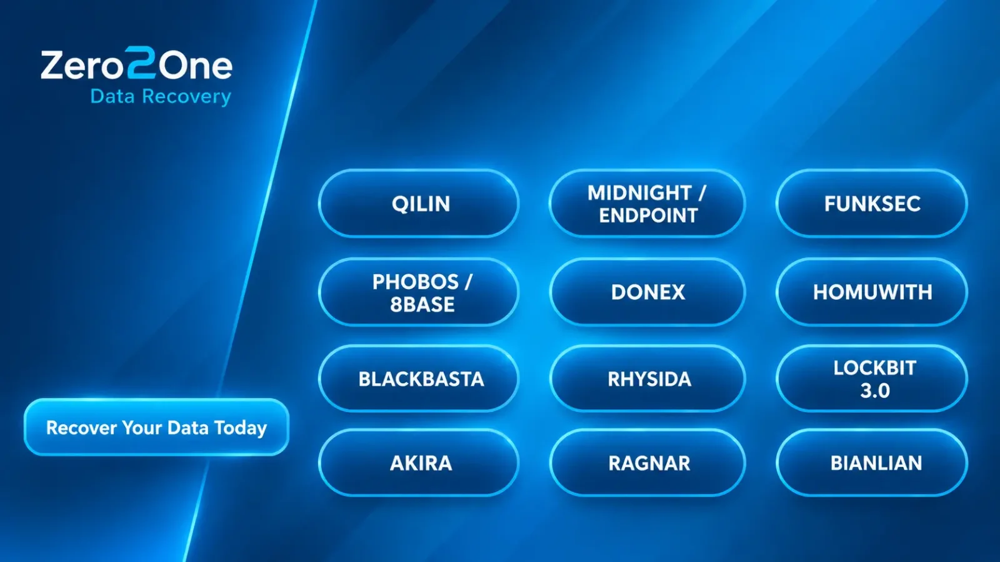
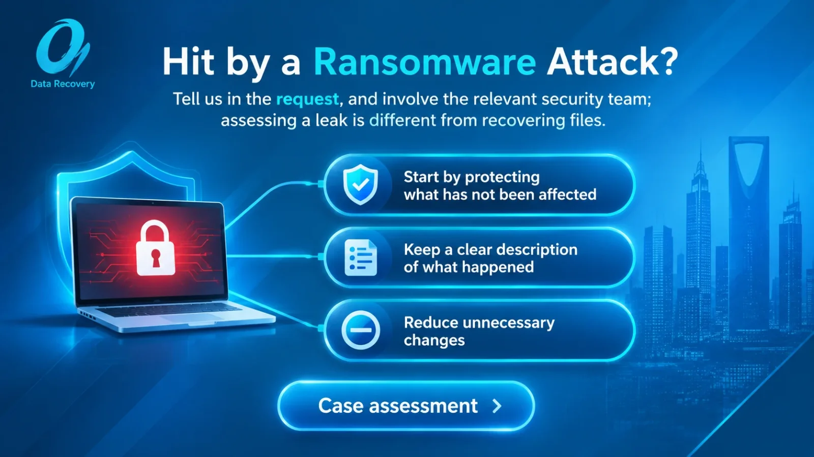

The next morning, your spreadsheets won't open. Your photos show an error. Every folder has a new text file called something like **RECOVER-FILES.txt**, and inside it is a calm, businesslike message: your files have been encrypted, and if you want them back, you'll pay in Bitcoin.

That's a ransomware attack. It hits hospitals, pipelines, airports, and car dealerships, but it also hits small offices and home computers every day. 

You will know what ransomware is, how an attack unfolds, the warning signs to look for, what to do in the first hours, and how to protect yourself and your [data recovery riyadh](https://datarecovery-sa.com/). 

## What Is Ransomware?

Ransomware is a type of malware that takes a victim's data or device hostage until a ransom is paid. Most modern ransomware encrypts files so they become unreadable, then demands payment, usually in cryptocurrency, for the decryption key. 

ome variants lock the whole screen instead, and many now steal data before encrypting it, then threaten to publish it if the victim refuses to pay. This is known as double extortion.

## Is Ransomware a Virus?

Not technically, though people often say "ransomware virus." Both are types of malware (malicious software), but they behave differently:

| **Type** | **What it is** | **Main goal** |
| **Malware** | The umbrella term for any malicious software | Damage systems, steal data, spy or disrupt |
| **Virus** | Malware that attaches to legitimate files and spreads when they run | Replicate and spread |
| **Ransomware** | Malware that encrypts or locks data and demands payment | Extort money |

**So all ransomware is malware, but not all malware is ransomware.**

## How Does a Ransomware Attack Work?

Most ransomware attacks follow a recognizable pattern.

**The way in**. Most infections start with a phishing email: a suspicious attachment or a link to a malicious webpage. Others come through unpatched software, exposed remote desktop (RDP) services, stolen passwords or compromised VPN accounts.

**Execution**. Once the attachment is opened, the malware quietly installs itself, often exploiting a flaw in the operating system to run its code.

**Spreading and preparation**. In business networks, attackers frequently spend days or weeks moving between machines, stealing credentials, and disabling backups before they strike. Ransomware is often delivered by earlier "dropper" malware such as Emotet, QakBot, Dridex or Bumblebee.

**Encryption**. The ransomware encrypts files, usually starting with the documents, databases and images people use most. They turn into what victims describe as "encrypted gibberish."

**The ransom note**. A text file or lock screen appears with payment instructions, typically in Bitcoin or another cryptocurrency, often with a deadline.

## How Do I Know If I Have Ransomware? Early Warning Signs

The sooner you spot ransomware, the more you can save. Warning signs appear at three stages of an attack.

### Before Encryption Starts

Attackers usually leave a trail before any file is touched: strange PowerShell commands, attempts to gain administrator privileges, or unsigned programs running quietly from temporary folders. 

Many organizations place canary files, hidden decoy files in sensitive folders, that act like tripwires. The moment an unknown process touches one, an alert goes off.

### During Encryption: The Critical Window

Things move fast here. Watch for rapid file changes, mass file renaming, unfamiliar file extensions (like .locked or .crypt), attempts to delete Windows shadow copies or disable backups, and unexplained CPU or disk spikes. 

Catching it at this stage means you can isolate the machine and stop the spread.

### After Encryption

Even once encryption has started, the attacker's movement can still be traced: mass registry changes, security tools that have been switched off or tampered with, credential-dumping activity, and unusual "lateral movement" from one computer to another across the network.

## Ransomware Extensions

One of the quickest clues is the extension added to your encrypted files. Some ransomware families use a fixed extension, while others generate random ones, so treat this list as a starting point rather than a definitive guide.

**Recently active strains (2025–2026)**: .**qilin** (the most famouse one), .akira, .dragonforce, .play, .interlock, .lockbit, .clop, .medusa

**Common and historical extensions**: .ecc, .xyz, .zzz, .encrypted, .locked, .crypto, .locky, .zepto, .xtbl, .wannacry, .ryuk, .dharma, .phobos, .djvu, .conti

To identify exactly which ransomware you're dealing with, upload the ransom note or a sample encrypted file to **ID Ransomware**, a free identification service. Knowing the strain tells you whether a free decryptor already exists.

## What to Do If You Suspect a Ransomware Attack

A ransom note on the screen, or many files failing at the same moment, is a signal to slow down and act in an organized way. If the devices belong to a business, involve your IT lead before touching servers or storage.

### Protect What Hasn't Been Affected

Disconnect suspected devices from the network: unplug the Ethernet cable and turn off Wi-Fi. Use a clean device to contact anyone. Keep healthy backups physically and logically separate from the infected environment.

### Write Down What Happened

Note when the problem was discovered, which services stopped, which devices are affected, and every action taken since. 

Keep the ransom note and logs unchanged. If you're not sure how to collect technical samples, leave that to the responsible team.

### Avoid Making It Worse

Don't format devices, delete files from the case, or run unknown "fix" tools on the original drives. Don't post the ransom note or company data on public forums asking for a diagnosis.

### Should You Shut the Computer Down?

It depends. Powering off can stop the spread, but it also wipes evidence stored in memory that investigators may need. 

[The U.S. Cybersecurity and Infrastructure Security Agency (CISA)](https://www.cisa.gov/stopransomware/ive-been-hit-ransomware) recommends disconnecting from the network first, and powering down only when isolation isn't possible. 

**In a business**, don't mass shut down servers based on a general guide like this one; follow your incident response lead.

### Should You Pay the Ransom?

Law enforcement agencies, including the government, advise against paying. Payment doesn't guarantee you'll get a working decryption key, it doesn't stop the attackers from leaking stolen data, and it funds the next attack. 

The decision is ultimately yours, but it should be made with legal and security advice, never in a panic.

**Read More**: [What should you do if you suspect a ransomware attack?](https://datarecovery-sa.com/en/ransomware/first-steps/)

## How Businesses Respond: Detection, Containment, and Recovery

For organizations, CISA's official ransomware guidance breaks the response into clear phases. Each one deserves its own playbook, but here is what they involve.

### Detection and Analysis

**Identify affected systems** and isolate them immediately. If several systems or subnets are hit, take the network offline at the switch level. 

**Prioritize isolating the systems** your daily operations depend on. For cloud resources, take snapshots of affected volumes for later forensic review.

Attackers often watch your emails and chats to see if they've been noticed, so coordinate isolation using out-of-band communication, such as phone calls, to avoid tipping them off.

**Then triage**: rank systems for restoration based on a predefined list of critical assets (health and safety, revenue, core services), and track the systems that appear unaffected so they don't slow the recovery.

### Threat Hunting

A ransomware event is often evidence of an older, unresolved compromise. Security teams look for:

- New Active Directory accounts or unexpected privilege escalation, especially Domain Admin activity
- Suspicious VPN or remote logins
- Misuse of built-in Windows tools such as vssadmin.exe, wbadmin.exe, bcdedit.exe and wmic.exe to delete shadow copies and block recovery
- Signs of Cobalt Strike beacons, unexpected remote monitoring and management (RMM) software, PowerShell or PsExec use
- Credential dumping with tools like Mimikatz
- Data exfiltration through tools such as Rclone or cloud file-sharing services

In cloud environments, automated alerts on changes to identity (IAM), firewall rules and data protection settings help teams catch attackers quickly without drowning in alerts.

### Reporting and Notification

Keep leadership, IT, your managed security provider and your cyber insurer informed. In the United States, report the incident to CISA, the FBI's Internet Crime Complaint Center (IC3) or a local FBI field office. 

Elsewhere, contact your national cybersecurity authority or CERT. If personal data was exposed, follow your legal breach notification requirements.

### Containment and Eradication

Preserve evidence first: system images, memory captures, logs and samples of the malware. 

Ask law enforcement whether a decryptor exists, since researchers sometimes find flaws in ransomware encryption. 

Then stop the ransomware processes, close the attacker's access points (VPNs, remote access servers, compromised accounts), and hunt down any persistence mechanisms they left behind.

### Recovery

Rebuild systems in order of business priority from clean, pre-configured images, reset passwords across affected systems, patch the vulnerabilities that let the attackers in, and only then declare the incident over.

## Ransomware Tools and Free Decryptors

Removing ransomware isn't the same as getting your files back. A removal tool can clean the infection, but it can't reverse strong encryption. That's why identification matters: if a decryptor exists for your strain, recovery may be free.

[**The No More Ransom Project**](https://www.nomoreransom.org/): A joint initiative backed by Europol and security companies, offering free decryption tools for many ransomware families. Always check here before considering payment.

[**ID Ransomware**](https://id-ransomware.malwarehunterteam.com/index.php): Identifies the ransomware strain from the ransom note or an encrypted file.

**Kaspersky Anti-Ransomware Tool**: A lightweight tool that uses cloud-assisted behavior detection to block ransomware and crypto-malware.

**Avast One**: Offers a free tier that includes ransomware protection for Windows, Android, Mac and iOS devices.

## Data Recovery After a Ransomware Attack

When your files or business systems stop because of encryption, it pays to understand your options before taking the next step. 

A professional recovery assessment looks at the damaged data and any alternative sources, such as backups, shadow copies, cloud versions or unencrypted file fragments, then explains the realistic scope of recovery and a plan that suits your case.

Recovery chances differ from one case to another, and the examination result is the basis for any estimate. Be cautious of anyone who guarantees recovery before seeing the data.

### [**_`Start a Ransomware Case Assessment Now`_**](https://datarecovery-sa.com/en/ransomware/assessment/)**_`!`_**

**_`Send a short description of the problem and a suitable way to reach you. This information helps us define what we need for the next step.`_**

### What should you do now?

Note that submitting a contact or assessment request is not the same as containing the attack. An active incident needs a response team inside your organization or a specialist incident response provider.

##  How to Avoid Ransomware Attack

There's no single product that stops every ransomware attack. The strongest approach is defense in depth: several layers, so that when one fails, the next one catches the attack.

### Everyday Habits

**Don't open unexpected attachments** **or click unverified links**, even from people you know.

**Keep your operating system and apps updated;** WannaCry spread through a Windows flaw that already had a patch available.

**Keep your antivirus switched on and up to date**.

**Don't pay or send money** through untrusted sites or payment requests.

### Antivirus vs Anti-Ransomware Protection

Traditional antivirus catches known threats by their signatures. Modern ransomware protection adds behavior-based detection, spotting a program that suddenly encrypts hundreds of files, even if it's brand new. 

**For businesses,** Endpoint Detection and Response (EDR) tools such as CrowdStrike Falcon, along with cloud configuration monitoring, add visibility across every device and cloud account.

### Detection and Investigation Tools for Businesses

Larger organizations combine several tools to spot attacks early. In the Cisco and Splunk ecosystem, for example:

- **Splunk collects system** logs in one place to flag suspicious activity like mass file encryption.
- **Cisco Secure Client Network Visibility Module (NVM)** feeds endpoint data into Splunk, highlighting unusual network connections and traffic to malicious command-and-control domains.
- **Cisco Secure Firewall Management Center (FMC)** uses threat intelligence and malware analysis to track malicious files and block ransomware at the network edge.

### Access Controls

Limit administrator rights, require multi-factor authentication (MFA) on email, VPN and remote access, and close remote desktop ports that don't need to face the internet.

## The Golden Rule: Bulletproof Backups

No defense is 100% foolproof, which is why planning for failure is essential. With solid backups, you can tell an attacker demanding a ransom to go away. Good backups follow the **"Four Rs"**:

1. **Recent**: Fresh enough that you don't lose crucial daily work.
2. **Redundant**: Multiple copies in different places, including at least one offsite or offline.
3. **Recoverable**: Tested regularly, so you know you're not backing up corrupted files.
4. **Read-only (immutable)**: Locked so ransomware can't reach your backup drive and encrypt it too.

For businesses, connecting storage monitoring to a security platform such as a SIEM or SOAR lets teams automate the response, isolate outbreaks instantly and turn a ransomware attack into a minor speed bump.

## Real-World Ransomware Attack Examples

The biggest attacks show how ransomware has evolved from mass email campaigns to targeted operations against critical services.

**WannaCry ransomware attack (2017)**: Exploited a Windows vulnerability to infect more than 200,000 systems across over 150 countries. It severely disrupted the UK's National Health Service (NHS), forcing thousands of cancelled appointments and procedures.

**Colonial Pipeline (2021)**: The DarkSide group forced the shutdown of a major U.S. fuel pipeline, and the company paid a $4.4 million ransom.

**Johnson Controls (2023)**: Attackers reportedly stole around 27 TB of data and demanded $51 million.

**CDK Global (2024)**: An attack on the automotive software provider disrupted thousands of car dealerships, with a reported $25 million payout.

**Synnovis and the NHS (2024)**: An attack on the London pathology provider disrupted hospital operations and patient care across the NHS.

**Collins Aerospace vMUSE (September 2025)**: Disrupted check-in and boarding systems at Heathrow, Brussels and Berlin airports.

**Dodd Group (October 2025)**: The Lynx group reportedly breached the UK Ministry of Defence contractor, stole about 4 TB of data, including files linked to military bases, then deployed ransomware and leaked documents.

### Conclusion

A ransomware attack is designed to make you panic: the deadline, the countdown, the locked files. The organizations and households that recover best are the ones that slow down, isolate the damage, preserve evidence and work from a plan.

The best defense is the unglamorous one: updated systems, careful email habits, layered security, and backups that are recent, redundant, tested and immutable. 

With those in place, a ransomware attack becomes an inconvenience you can recover from rather than a ransom you feel forced to pay.

## Frequently Asked Questions

### Can ransomware be removed?

**Yes**. Antivirus and dedicated removal tools can clean the infection. But removal doesn't decrypt your files. For that you need a decryptor for your specific strain, a clean backup, or professional recovery.

### Can you recover files after a ransomware attack without paying?

**Often, yes**. Restore from clean backups, check No More Ransom for a free decryptor, and look for cloud file versions or shadow copies that may have survived. A professional assessment can tell you what's realistic.

### Does antivirus stop ransomware?

Modern antivirus with behavior-based ransomware protection stops many attacks, but not all. That's why backups, updates and access controls matter just as much.

### How did the WannaCry ransomware attack spread?

WannaCry used a vulnerability in the Windows SMB file-sharing protocol to spread automatically from computer to computer, without anyone clicking anything. Microsoft had released a patch shortly before, so unpatched systems were hit hardest.

### What are ransomware extensions?

They are the file extensions ransomware adds to encrypted files, such as .qillin .lockbit or .akira. They help identify the strain, especially with tools like ID Ransomware.

### Should I report a ransomware attack?

Yes. Reporting helps law enforcement track groups, may connect you with decryptors, and can be a legal requirement if personal data was exposed.

**Resourses:**

- [15 Examples of recent Ransomware Attacks | Trend Micro](https://www.trendmicro.com/en/what-is/ransomware/ransomware-examples.html)
- [I've Been Hit By Ransomware! | CISA](https://www.cisa.gov/stopransomware/ive-been-hit-ransomware)
- [ID Ransomware](https://id-ransomware.malwarehunterteam.com/index.php)
